# UI/UX Rescue Challenge — Campus Lost & Found

**User scenario:** a student lost an item and wants to find a matching notice; another student found an item and wants to report it so it can be recovered through a campus collection point.

Changed files: `src/App.jsx`, `src/styles.css`. No new dependencies, and the data model is unchanged apart from one extra handover value (`dropped`).

## Main action and one unsuccessful action

| | Before | After |
|---|---|---|
| Main action — find a lost item | 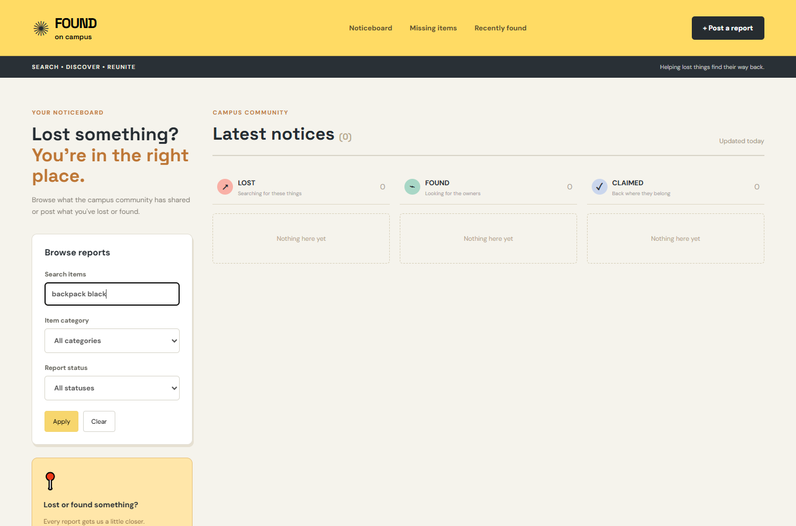 | 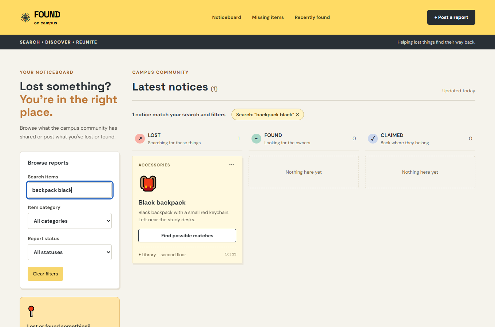 |
| Unsuccessful action — submit a duplicate |  | 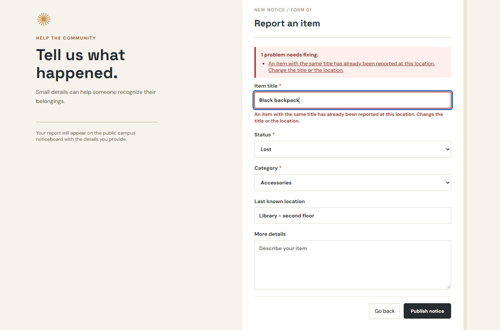 |

---

## 1. Form errors told the user nothing (error prevention / recovery)

**Goal:** publish a report and fix mistakes quickly.
**Problem:** `validate()` produced a precise message, but `submit()` discarded it and always showed *"Please review your entries."* — even for a duplicate title/location, which the user could not diagnose. The `*` marker also wrapped onto its own line.
**Fix:** errors are returned per field and shown next to the field (red outline + text), with an error summary of links, `aria-invalid`/`aria-describedby`, focus moved to the first invalid field, errors cleared as the user corrects them, and a visible keyboard focus ring. The duplicate message now says how to resolve it.
**Preserved:** every original rule (title ≥ 2 chars, category, status, same title + location rejected).

| Before | After |
|---|---|
| 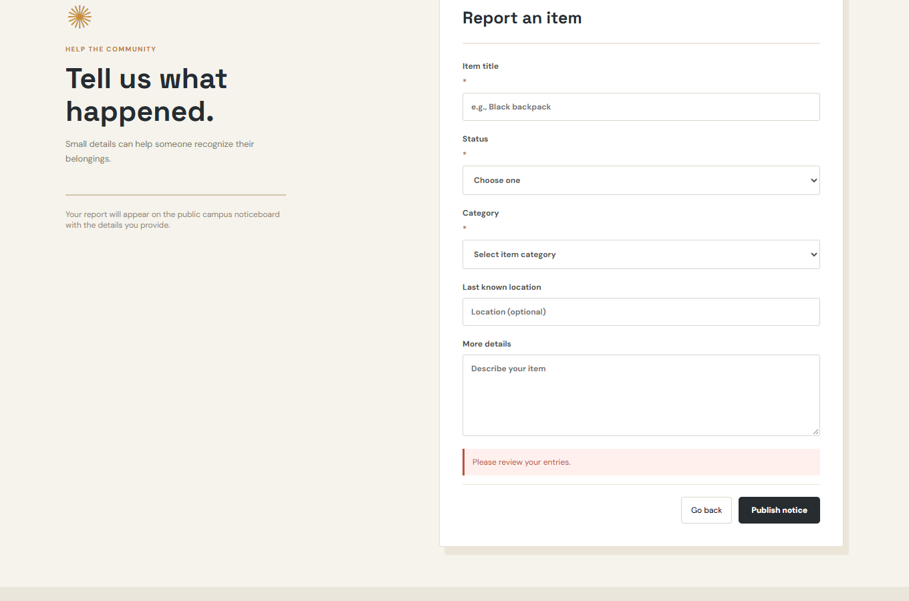 | 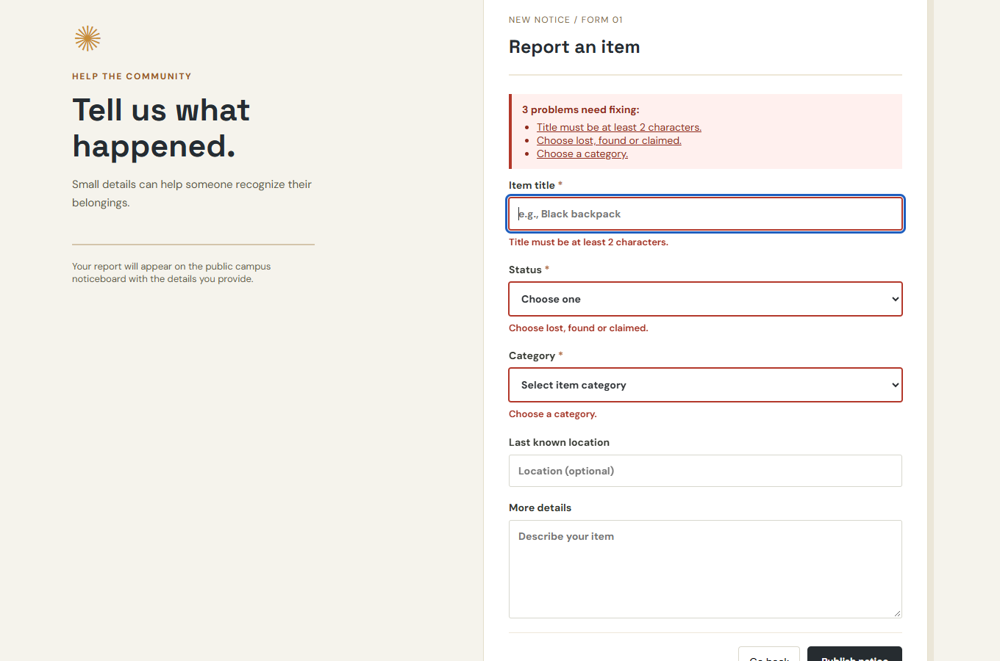 |

## 2. Hard to find a matching notice (flexibility, feedback, empty states)

**Goal:** someone who lost a black backpack wants the notice that matches it.
**Problems:**
- Search matched only the exact phrase, so *"backpack black"* found nothing for "Black backpack".
- **Apply** did nothing — filters were already live — and only popped a toast.
- Zero results showed three separate "Nothing here yet" boxes with no next step.
- The header shortcuts kept stale search text/category hidden in the sidebar.

**Fix:** all typed words must match, in any order (title, location, description, category); the misleading Apply button is gone; a live result count and removable filter chips show what is active; the empty state explains what to try and offers *Clear filters* / *Post a report*; the user's own lost reports get **Find possible matches** (found items in the same category); header shortcuts reset stale filters.

| Before (no results for reordered words) | After |
|---|---|
|  | 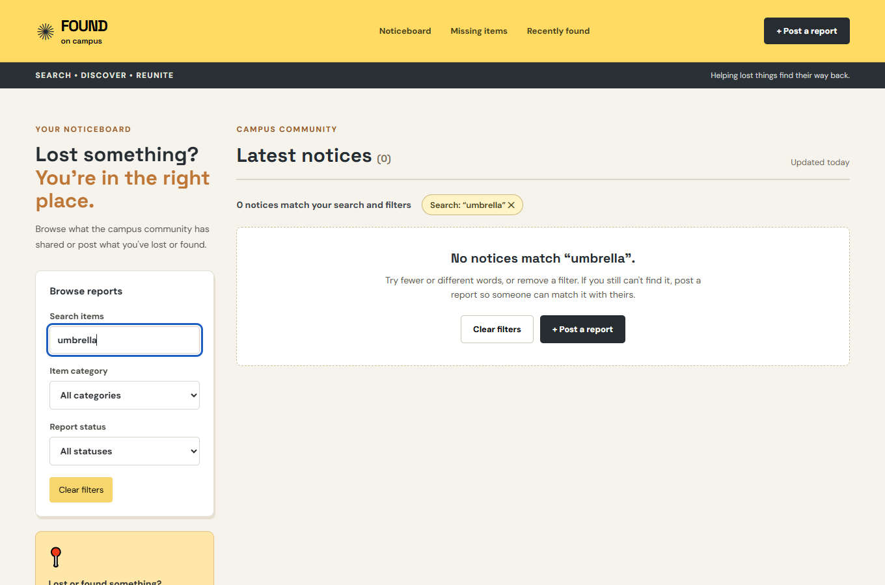 |

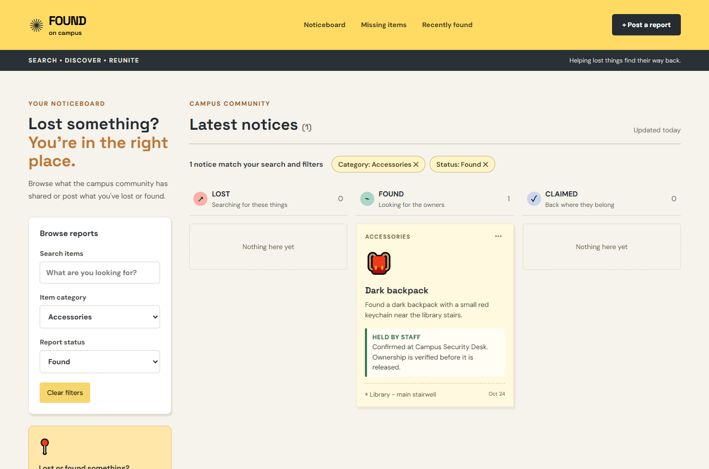

## 3. Unclear whether a found item is really at a collection point (trust, visibility of system status) + legibility

**Goal:** a finder wants to hand the item over; an owner wants to know where to go and whether to trust it.
**Problems:**
- A finder had no way to say where the item is; every new found report was permanently "not confirmed".
- The status line was a small grey sentence; much text was 9–11 px in low-contrast greys.

**Fix:** found reports ask *Where is the item now?* (still have it / left at a collection point, with a required point). A finder's claim is stored as **Not yet confirmed**, never *Held by staff*, because only staff can confirm receipt — this respects the brief's rule that a report is not automatically confirmation. Cards show a labelled status (**Held by staff**, **Not yet confirmed**, **Reported only**, **Collected**) with plain-language guidance, not colour alone. Staff-confirmed/collected records cannot have their handover rewritten when edited. Body text is raised to ≥ 12–14 px with darker greys.

| Before | After |
|---|---|
| 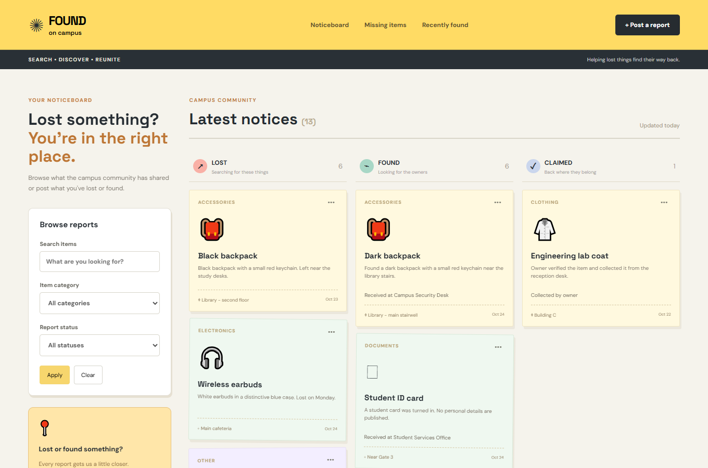 | 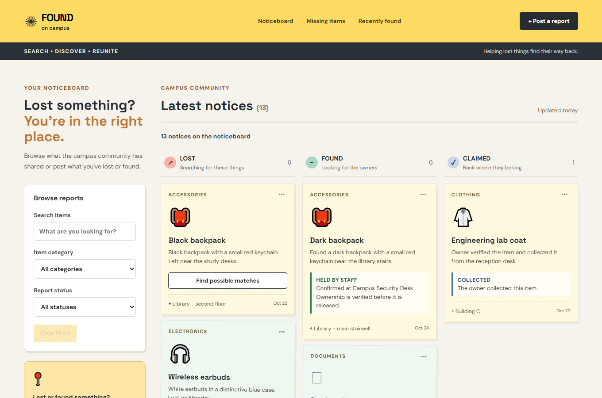 |
| 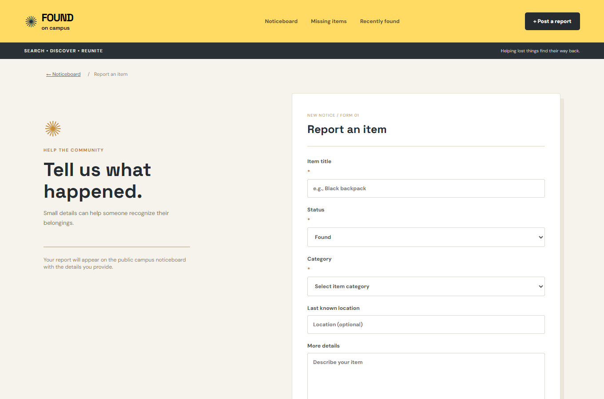 | 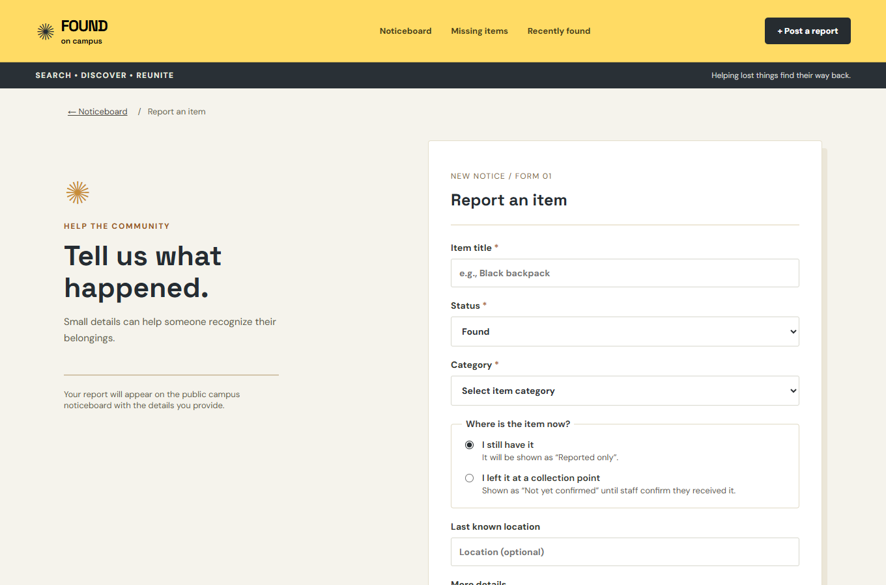 |

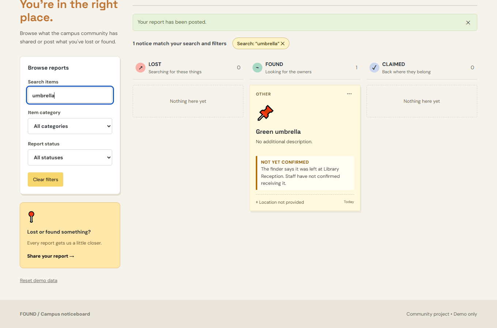

---

## AI design suggestion I refined / rejected

**Suggestion (AI):** when a finder picks a collection point, immediately show the item as *"Received at <point>"* so owners get a clear destination and the board looks consistent.

**Decision — rejected as proposed, refined:** it would present an unverified claim as fact and break the brief ("a reported item is not automatically confirmed as being held by staff"). Owners could travel to a desk that has nothing. I kept the idea of a clear destination but introduced a separate **Not yet confirmed** state that still names the point, reserving **Held by staff** for records staff confirmed.

**Alternative also weighed (search):** fuzzy/synonym matching (so "dark" ≈ "black"). Rejected for this scope — it adds opaque, hard-to-test results; an all-words search plus a category-based *Find possible matches* shortcut gives most of the benefit predictably.

## Testing

Run in a real browser (Edge, headless, via puppeteer-core) against `npm run dev`; 29/30 checks passed and the remaining one was only the missing `favicon.ico` 404 that exists in the starter pack:

- seed data loads (13 notices); Reset demo data restores it
- search order-independence, single word, no-result guidance, clear filters, filter chips, *Find possible matches*, header shortcuts
- unsuccessful actions: empty form, 1-character title, duplicate title + location, found-at-collection-point without choosing a point
- main action: valid report posts; own reports editable, other students' reports not editable
- editing a staff-confirmed item keeps its confirmation; focus moves to the first invalid field
- `npm run build` succeeds
